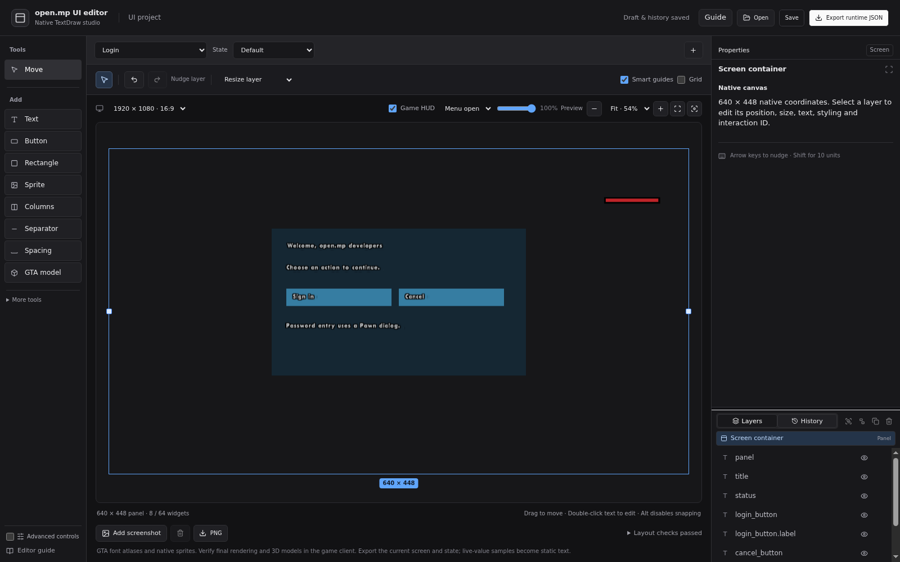

# open.mp UI editor

[Open the live editor](https://abdulrahman1s.github.io/open-mp-ui-editor/) · [Download releases](https://github.com/abdulrahman1s/open-mp-ui-editor/releases) · [Format contract](docs/FORMAT.md)

Design native open.mp interfaces in your browser, export JSON, and handle buttons through Pawn callbacks. No editor installation, account, backend or client browser plugin is required. The runtime is an open.mp **component**, with Rust managing definitions, player instances, validation and resource ownership.



Version **0.1.0** is an initial release. Automated tests cover the editor, format contract, runtime lifecycle and real Linux i686 open.mp SDK/Pawn integration. Browser fonts are approximate; final appearance and controls must be checked in a GTA client before deploying your UI.

## Features

- Visual layers, positioning, resizing, colors, native font settings, sprites and model previews.
- Undo/redo, grouping, locking, snapping, zoom, screenshots and transparent PNG previews.
- Local browser drafts, editable project files, CSS-style source, and runtime JSON import/export.
- Unique element IDs, native selectable textdraws and `OnUIClick` / `OnUICancel` callbacks.
- Shared immutable definitions with independent per-player instances and text/color/bounds updates.
- Strict versioned JSON, path confinement, bounded resources, partial-allocation rollback and automatic cleanup.
- Login, HUD, inventory, menu and button-panel examples.

This evolves the existing Interface studio editor: the React workspace, store, layer model, gesture tools and layout planner are retained. [Architecture and assessment](docs/ARCHITECTURE.md) explains the export/runtime seam.

## Supported platforms

| Platform | Artifact | Runtime |
| --- | --- | --- |
| Linux x86 (32-bit) | `open-mp-ui-editor-linux-x86.zip` | open.mp 1.5.8.3079 |
| Windows x86 (32-bit) | `open-mp-ui-editor-windows-x86.zip` | open.mp 1.5.8.3079 |

Linux runs the real-server integration suite. Windows builds in CI; an interactive Windows/GTA session is not part of automated verification. The component uses the official stable SDK, pinned by commit, and requires the bundled Pawn and TextDraws components. This is **not** a SA-MP legacy plugin: do not put it in `plugins/` or `pawn.legacy_plugins`. Other open.mp versions are not currently part of the compatibility matrix.

## First UI in five minutes

1. Download the archive matching your server OS from [Releases](https://github.com/abdulrahman1s/open-mp-ui-editor/releases).
2. Copy `components/open-mp-ui-editor.so` (Linux) or `.dll` (Windows) into your server's `components/` directory. Keep the standard Pawn and TextDraws components enabled. Restart the server.
3. Copy `pawn/include/open_mp_ui_editor.inc` into your Pawn compiler's include directory.
4. Create `scriptfiles/ui/` and copy `examples/login.json` there as `login.json`.
5. Compile [quickstart.pwn](pawn/examples/quickstart.pwn) with your open.mp compiler/includes. Add its AMX to your server's gamemodes or integrate its callbacks into your existing mode.

The example opens the login panel on connect. Clicking **Sign in** updates its status through Pawn; **Cancel** destroys the instance. Escape hides it. Account authentication is supplied by your own game mode; the example demonstrates UI interaction.

```pawn
#include <open.mp>
#include <open_mp_ui_editor>

new UI:gLogin;
new UIInstance:gInstance[MAX_PLAYERS];

main() {}

public OnGameModeInit()
{
    gLogin = UI_Load("login.json");
    return 1;
}

public OnPlayerConnect(playerid)
{
    gInstance[playerid] = UI_Show(playerid, gLogin);
    if (gInstance[playerid] != UI_INSTANCE_INVALID)
        UI_Select(playerid, gInstance[playerid]);
    return 1;
}

public OnUIClick(playerid, UI:ui, UIInstance:instance, const elementId[])
{
    if (ui != gLogin || instance != gInstance[playerid]) return 1;
    if (!strcmp(elementId, "login_button"))
        UI_SetText(playerid, instance, "status", "Button received by Pawn.");
    else if (!strcmp(elementId, "cancel_button"))
    {
        UI_Destroy(playerid, instance);
        gInstance[playerid] = UI_INSTANCE_INVALID;
    }
    return 1;
}

public OnUICancel(playerid, UIInstance:instance)
{
    UI_Hide(playerid, instance);
    return 1;
}

public OnPlayerDisconnect(playerid, reason)
{
    #pragma unused reason
    gInstance[playerid] = UI_INSTANCE_INVALID;
    return 1;
}

public OnGameModeExit()
{
    UI_Unload(gLogin);
    return 1;
}
```

Use the complete [quickstart](pawn/examples/quickstart.pwn) for player class setup and load-error reporting. All operations return `0`/`false` on failure. `UI_GetLastError` retrieves the most recent runtime error; the component also logs failed native operations without logging definition contents.

## Using the editor

Open the [public editor](https://abdulrahman1s.github.io/open-mp-ui-editor/). The initial examples use exact native primitive bounds. Select an element in Layers or on the canvas; change its ID, geometry, text, color and interaction flags in Properties. Drag to move; side/corner handles resize; arrow keys nudge. Ctrl/Cmd+Z undoes. Group related layers with Ctrl/Cmd+G. Resize changes the container; **Scale layer & text** scales its presentation.

Create a new screen with the **+** beside the screen selector. New compact/column layouts retain the original flow-based tools and stylesheet editor. Add buttons with unique IDs in their Interaction properties. Runtime interactions are the element IDs, regardless of the legacy action label shown in flow-layout controls. **No action** disables export of that button's click target.

- **Save** stores editable project JSON, including flow layout and preview samples. Browser drafts also survive refresh when browser storage permits. Download projects to keep a durable backup.
- **Open** accepts project JSON, runtime JSON and the editor's CSS-style source. Runtime import creates positioned native primitives; original flow/group metadata is available in the project file.
- **Export runtime JSON** downloads the selected screen and state, after validation. Copy this file to `scriptfiles/ui/` and load its filename from Pawn. Each screen exports separately.
- **PNG** exports a transparent preview; **Add screenshot** places a local GTA screenshot behind the UI for alignment. Screenshots stay in the current browser session and are not uploaded.
- The stylesheet panel is a restricted TextDraw layout language, not arbitrary CSS/HTML. It can be copied or edited without a backend.

Live-value fixtures and conditional sections are resolved at export. They are not a runtime expression language. Use stable element IDs and `UI_SetText` to publish live player data. Export warnings call out frozen values, uncached sprites and model previews. Invalid bounds, IDs and unsupported text block export.

## Pawn interface

`UI:0` and `UIInstance:0` are invalid. Definition and instance handles are distinct, monotonic and owned by the loading Pawn script. A different filterscript cannot manipulate another script's UIs.

| Function | Behaviour |
| --- | --- |
| `UI:UI_Load(filename[])` | Load a validated JSON definition beneath `scriptfiles/ui/`. |
| `UI_Unload(UI:ui)` | Destroy all its player instances, then unload the definition. |
| `UIInstance:UI_Show(playerid, UI:ui)` | Create a **new**, visible instance; repeated calls create multiple instances. |
| `UI_Hide(playerid, instance)` | Hide the existing instance, retaining its state and allocated resources. |
| `UI_ShowInstance(playerid, instance)` | Show that same instance again; selection must be requested again. |
| `UI_SetVisible(playerid, instance, bool:visible)` | Explicit equivalent of hide/show-instance. |
| `UI_Destroy(playerid, instance)` | Release the instance and its textdraws. |
| `UI_Select(playerid, instance, hoverColor)` | Enable native selection and focus this instance; default color `0x80BFE0FF`. |
| `UI_SetText(playerid, instance, elementId[], text[])` | Update plain text or native sprite name, within the original element bounds. |
| `UI_SetColor(playerid, instance, elementId[], color)` | Set `0xRRGGBBAA` color. |
| `UI_SetBounds(playerid, instance, elementId[], Float:x, Float:y, Float:w, Float:h)` | Update native position and bounds; no browser reflow. |
| `UI_SetEnabled(playerid, instance, elementId[], bool:enabled)` | Enable/disable click dispatch; appearance is controlled separately. |
| `UI_SetElementVisible(playerid, instance, elementId[], bool:visible)` | Show/hide one primitive. Button captions/backgrounds may be separate IDs. |
| `UI_SetSelectable(playerid, instance, elementId[], bool:selectable)` | Change whether a primitive participates in native selection. |
| `UI_GetElementCount(UI:ui)` | Definition primitive count. |
| `UI_GetElementId(UI:ui, index, elementId[], size)` | Read an element ID (zero-based index; buffer at least 65 cells recommended). |
| `UI_GetLastError(message[], size)` | Copy the most recent runtime error. |

Callbacks go only to the script that loaded the definition:

```pawn
forward OnUIClick(playerid, UI:ui, UIInstance:instance, const elementId[]);
forward OnUICancel(playerid, UIInstance:instance);
```

Use `ui` to identify the shared definition and `instance` to identify one presentation. Only the focused instance dispatches clicks. Escape consumes focus before calling `OnUICancel`; callbacks can safely hide/destroy/show/select another instance. Hiding or destroying the focused instance ends selection. `UI_Select` is explicit so a HUD does not automatically take control of the cursor. No handler needs to map native textdraw IDs.

Disconnect automatically destroys all the player's instances. AMX unload destroys all that script's definitions/instances; component reset/free cleans up everything. Clear your own Pawn instance variables on disconnect. Treat clicks as untrusted input and validate gameplay authorization and current state in your mode.

## Rendering limitations

This uses [native player textdraws](https://open.mp/docs/scripting/resources/textdraws), not a browser overlay. Supported primitives are text (fonts 0–3), rectangles/sprites (font 4) and GTA model previews (font 5).

- Coordinates use the client's **640 × 448** projection, independent of physical display resolution. Legacy flow layout uses a 480-unit design extent; runtime export additionally requires every primitive to fit the actual 448-unit projection.
- Text is single-line printable ASCII, up to 512 bytes. Runtime text cannot contain `~`, `%`, `{` or `}`. Multiple lines export as separate primitives. Font sizes and bounding boxes do not guarantee text fits; check captions in the client. There is no arbitrary Unicode/browser font support.
- Native rectangles have no rounded corners, gradients, blur or CSS effects. Borders are multiple primitives. No HTML, embedded browser, native text input, scrolling container or runtime animation engine is provided. Use open.mp dialogs for input and Pawn updates for state changes.
- Browser font preview is approximate. No extracted GTA font atlases, texture bitmaps or HUD captures are distributed. Sprite catalogue names are retained; the browser displays labeled placeholders. Model previews are placeholders too. The game resolves installed textures/models; unknown names cannot be verified headlessly.
- Native selection supplies hover tint and click/cancel events. It does **not** expose general hover-enter/leave or pointer-move callbacks. Selection is global per player: coordinate with other textdraw/dialog systems, and select the instance currently accepting interaction.
- The server shares immutable definitions, but each visible/hidden instance uses player textdraws. Limits: 256 definitions server-wide, 128 primitives/definition, 8 instances/player, 256 owned primitives/player, 256 KiB/file. Other scripts share the engine's 256-player-textdraw pool; allocation failure rolls back the new instance. Destroy unused instances; hiding retains its budget.
- Updates skip identical values and touch only the changed primitive. Style/bounds changes restream that primitive. No per-tick full-layout rebuild occurs.

See [format](docs/FORMAT.md), [architecture](docs/ARCHITECTURE.md) and [verification](docs/TESTING.md).

## Local development and checks

Requirements: Node.js 24+, Python 3.11+, Rust stable with Clippy/rustfmt, CMake 3.24+, Ninja and a C++17 compiler. Windows uses Visual Studio 2022 with C++ desktop tools. Native release builds need the 32-bit Rust target and matching compiler/libraries. CMake fetches the pinned official SDK and Pawn headers; no game installation is needed.

```sh
cd editor
npm ci
npm test
npm run format:check
npm run build
cd ..
node scripts/export-examples.cjs
cargo fmt --all --check
cargo clippy --all-targets --locked -- -D warnings
cargo test --locked
python3 scripts/site.py
python3 -m http.server 8877 --directory site
```

Open `http://localhost:8877/`. All assets are relative; there are no SPA routes requiring a backend rewrite.

Build Linux (with an installed i686 Rust target and multilib compiler):

```sh
rustup target add i686-unknown-linux-gnu
python3 scripts/build.py --target i686-unknown-linux-gnu
python3 scripts/build.py --target i686-unknown-linux-gnu --test-driver
python3 scripts/integration.py
python3 scripts/package.py linux-x86 build-linux/open-mp-ui-editor.so
```

On NixOS, use the locked flake in `nix/`. The default shell supports browser development, formatting, Clippy and host tests. The i686 shell supplies 32-bit Rust/C++ plus open.mp/Pawn loaders and runtime libraries:

```sh
nix develop ./nix
nix develop ./nix#i686 --command python3 scripts/build.py --target i686-unknown-linux-gnu
nix develop ./nix#i686 --command python3 scripts/build.py --target i686-unknown-linux-gnu --test-driver
nix develop ./nix#i686 --command python3 scripts/integration.py
```

Run these from the standalone project root. The flake's directory contains only Nix configuration; it does not copy the project or surrounding private files into the store. The host shell supports x86_64-linux and aarch64-linux; the native i686 shell requires x86_64-linux. Nix dev binaries use the locked Nix libraries. Portable release artifacts are built separately in CI against a pinned older sysroot with Nix RPATHs removed. No `apt`, system library changes or hardcoded store hashes are needed.

Existing open.mp distributions can be used read-only for integration with `--server /path/to/Server --includes /path/to/includes`. Every test still runs in a temporary server directory.

Build Windows in a Visual Studio developer shell:

```powershell
rustup target add i686-pc-windows-msvc
python scripts/build.py --target i686-pc-windows-msvc
python scripts/package.py windows-x86 build-windows/Release/open-mp-ui-editor.dll
```

Do not distribute a `--test-driver` binary: it includes private event-injection natives. The release workflow builds production and test outputs separately.

## CI, Pages and releases

Pull requests and pushes run formatting, editor/schema tests, host Rust tests, web builds, Linux/Windows x86 builds, Pawn compilation and the isolated Linux open.mp integration test. CI also loads browser-generated examples through the actual Rust runtime interface.

After initial repository setup, every passing `main` build deploys the static editor through official GitHub Pages actions. Repository **Settings → Pages → Source** must be **GitHub Actions**. Relative assets work at `/open-mp-ui-editor/` and custom base paths. No backend or secrets are needed for editing.

Semantic version tags (`v0.1.0`, etc.) run the same checks, build both native artifacts, and publish archives, includes, examples, documentation and SHA-256 manifests through GitHub Releases. Version bumps update Cargo.toml/Cargo.lock, editor/package.json/lock, CMake component version, package.py and CHANGELOG.md together. Archive ordering and timestamps are deterministic; binary reproducibility also depends on the pinned toolchain/SDK/environment.

The root `pawn.json` declares the include and per-platform release resources for sampctl/Pawndex. With a current sampctl and an open.mp runtime, `sampctl install abdulrahman1s/open-mp-ui-editor` installs the include; resource file mappings place the component binary in `components/`. Verify the startup log after restarting. [Pawndex](https://packages.open.mp/packages) harvests public GitHub metadata; its public API is read-only and indexing timing is controlled by the registry operator. The component binary must be installed to `components/` even when the include is installed with sampctl.

## Troubleshooting and FAQ

**The server reports unknown UI natives.** Put the matching 32-bit binary in `components/`, retain Pawn/TextDraws, restart, and check for `[open-mp-ui] 0.1.0 ready`. A component in `plugins/` will not work.

**UI_Load returns zero.** Call `UI_GetLastError`. Filenames are relative to `scriptfiles/ui/`, case-sensitive on Linux, and must end in `.json`. Project JSON/CSS is not a runtime file. Re-export with **Export runtime JSON**. Absolute paths, traversal and escaping symlinks are rejected.

**The UI shows but buttons do nothing.** Set a unique valid ID, enable Selectable/Enabled, show the instance, then call `UI_Select`. Check the callback signature exactly. Only the focused instance receives clicks. Selection interferes with other cursor/textdraw systems unless your mode coordinates them.

**I hit the resource limit.** Destroy old instances before repeatedly calling `UI_Show`; use `UI_ShowInstance` for an already created instance. Hiding retains resources. Button captions, fills and borders each consume primitives.

**My text differs from the preview.** Public preview uses browser fonts and cannot reproduce GTA glyph metrics. Adjust native sx/sy and bounds, then compare in a real client. Sprites/models render in-game from native names, not uploaded browser images.

**Can I use a shared HUD?** Load one definition and show it for each player; updates affect only that player's instance. Native global textdraw pooling is not implemented in this release. Never select a passive HUD unless it needs interaction.

**Can I edit offline?** After building/downloading the editor assets, serve them with any static server; editing and exporting use no backend. Browser storage is optional. File picker support varies; download and `<input type=file>` fallbacks are included.

## Contributing and license

See [CONTRIBUTING.md](CONTRIBUTING.md). MIT for project code; [third-party notices](THIRD_PARTY_NOTICES.md) identify retained licenses and SDK/header dependencies. This project is community software and is not affiliated with Rockstar Games. Game assets are not included.
